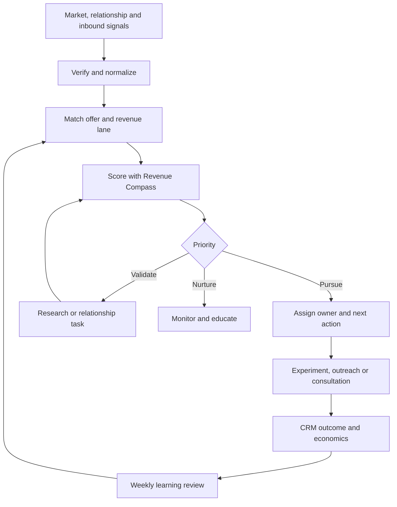

# Marketing Engineer Revenue Compass

**Module:** Veritas Development Intelligence OS  
**Status:** Proposed operating module  
**Owner:** Dennis Eng  
**Business approver:** David Poole  
**Primary market:** Lee's Summit / Kansas City metro  
**Review cadence:** Weekly compass review; monthly portfolio review

## 1. Purpose

The Marketing Engineer Revenue Compass turns Veritas's market intelligence, relationships, project knowledge, website activity, capital mandates, and operational capacity into a ranked set of revenue actions.

It answers five management questions:

1. Where is the strongest current demand or opportunity signal?
2. Which Veritas offer best converts that signal into revenue?
3. Which relationship or channel provides the fastest credible path?
4. What evidence is required before Veritas commits time or money?
5. What is the next highest-value action, who owns it, and when is it due?

The Compass is not another CRM. Frappe remains the operational system of record. The Compass is the decision layer that recommends where the team should focus.

## 2. Why This Module Exists

The repository already contains valuable but distributed assets:

- company positioning and portfolio evidence;
- Jackson County and Lee's Summit market intelligence;
- project, incentive, demographic, policy, and community signals;
- capital-source criteria and investor research;
- SEO audits and content clusters;
- outreach playbooks;
- Veritas OS agent and governance architecture.

The missing layer is a repeatable method for converting these inputs into prioritized, testable revenue opportunities. The Compass connects intelligence to an offer, audience, channel, experiment, owner, next action, and measurable commercial outcome.

## 3. Revenue North Star

> Create qualified, evidence-backed opportunities that Veritas can convert into near-term fees, construction revenue, capital-advisory income, or long-term development profit.

Every recommended action must map to at least one revenue engine:

| Revenue engine | Typical offer | Commercial horizon |
|---|---|---|
| Site and feasibility services | Site Potential Review, Development Readiness Assessment | Near term |
| Construction services | Excavation, concrete, site preparation, renovation, project execution | Near to medium |
| Development advisory | Owner representation, pre-development, project recovery | Near to medium |
| Financing and capital advisory | Capitalization Blueprint, lender/capital matching | Near to medium |
| Development participation | Land control, JV, Co-GP, promote, finished-lot monetization | Medium to long |
| Referral and partner channel | Qualified project, builder, lender, or professional introductions | Ongoing |

## 4. Compass Directions

Each opportunity is evaluated through four directions.

### North — Market Pull

Evidence that the market is requesting or enabling action:

- planning, zoning, permit, entitlement, or infrastructure activity;
- land listing, transfer, distress, succession, or stalled-project signal;
- owner inquiry or website address search;
- builder lot requirement or construction demand;
- lender or investor mandate;
- public incentive or economic-development program;
- local search demand, community question, or competitor gap.

### East — Relationship Access

The credible path to the decision maker:

- direct relationship;
- warm introduction;
- realtor, broker, engineer, attorney, lender, CPA, title, or municipal referral;
- existing vendor or subcontractor network;
- inbound website engagement;
- LinkedIn or local-event connection;
- verified direct outreach path.

### South — Delivery Readiness

Veritas's ability to deliver profitably:

- geographic and service-line fit;
- staff and partner capacity;
- verified credentials and proof;
- preliminary scope and economics;
- municipal and professional-review requirements;
- financing and capital readiness;
- delivery risk, reputation risk, and approval requirements.

### West — Revenue Velocity

How quickly the opportunity can produce a meaningful commercial outcome:

- fee or deposit available now;
- identifiable decision date;
- budget or capital source;
- clear next paid milestone;
- sales-cycle length;
- probable gross margin;
- lifetime and referral value;
- strategic option value.

## 5. Opportunity Classes

The Compass maintains separate lanes so large development ambitions do not crowd out near-term revenue.

1. **Cash Now:** scopes capable of producing fees or deposits inside 30 days.
2. **Build Pipeline:** construction and project opportunities expected inside 30–120 days.
3. **Capital Pipeline:** qualified financing, equity, Co-GP, or sponsor-capital engagements.
4. **Land and Development:** control, entitlement, JV, acquisition, or owner-partnership opportunities.
5. **Channel Assets:** relationships that can repeatedly originate opportunities.
6. **Authority Assets:** content, proof, tools, or events that materially improve conversion.

## 6. Opportunity Score

Score every opportunity from 0–100.

| Dimension | Weight | Test |
|---|---:|---|
| Signal strength | 15 | Is the need current, verified, and specific? |
| Strategic fit | 15 | Does it match Veritas's market, capability, and positioning? |
| Decision-maker access | 10 | Is there a credible route to the person who can act? |
| Revenue potential | 15 | Is the likely revenue or strategic value meaningful? |
| Revenue velocity | 15 | Can a paid milestone occur soon? |
| Deliverability | 10 | Can Veritas execute with available people and partners? |
| Evidence quality | 10 | Are claims supported by current, attributable evidence? |
| Repeat/referral value | 5 | Can this create additional opportunities? |
| Capital readiness | 5 | Is a realistic capital path present when required? |

Apply deductions:

- unclear property control: −10;
- outside active service area: −15;
- no identified decision maker: −10;
- major unverified claim or stale source: −15;
- legal, securities, licensing, or reputation concern: −20;
- no next paid milestone: −10.

### Decision bands

| Score | Direction |
|---|---|
| 80–100 | Pursue now; executive owner and immediate next action |
| 65–79 | Validate within seven days |
| 45–64 | Nurture, enrich, or partner |
| Below 45 | Archive or monitor until a stronger trigger appears |

A high score is not permission to contact, quote, spend, or commit. Existing Veritas approval levels still apply.

## 7. Signal-to-Revenue Workflow



### Required opportunity record

Every Compass item should contain:

- opportunity ID and title;
- signal type, date, source, and evidence link;
- property, organization, contact, and project relationships;
- target audience and decision maker;
- matched Veritas offer;
- revenue lane and estimated value range;
- Compass score and rationale;
- confidence level;
- risk and professional-review flags;
- recommended next action;
- human owner and due date;
- campaign and channel attribution;
- current stage and latest outcome;
- estimated cost and actual cost;
- revenue, gross margin, and learning captured.

## 8. Veritas Offer-to-Signal Map

| Signal | Audience | First offer | Expansion path |
|---|---|---|---|
| Property address search | Owner/investor | Site Potential Review | Feasibility, construction, financing |
| Underused or listed parcel | Landowner/buyer | Development Readiness Assessment | Land control, JV, development |
| Permit or planning activity | Owner/developer | Site/project diagnostic | Construction or owner representation |
| Stalled/undercapitalized project | Sponsor/owner | Project Recovery Diagnostic | Capitalization and execution |
| Builder seeks lots | Builder | Builder/Finished-Lot Partnership | Takedown, JV, site development |
| Investor/lender mandate | Capital source | Qualified opportunity matching | Financing or project capitalization |
| Commercial refinance/acquisition | Owner/investor | Capitalization Blueprint | Financing placement and advisory |
| Infrastructure or incentive signal | Landowner/developer | Incentive/site strategy session | Development services |
| Realtor referral | Realtor/client | Development Potential Snapshot | Assessment, construction, capital |
| Community question/search demand | Local audience | Evidence-backed guide or event | Consultation and referral capture |

## 9. Marketing Engineer Systems

### 9.1 Market and Site Truth

Maintain source-backed intelligence for parcels, planning, permits, infrastructure, incentives, demographics, construction demand, capital conditions, and community friction.

Output: verified signals, not generic market summaries.

### 9.2 Developer Authority

Convert Veritas's projects, experience, decisions, site activity, and partner knowledge into proof:

- case studies;
- project milestone stories;
- site and feasibility explainers;
- construction process evidence;
- capital-readiness education;
- local development insights.

Output: evidence that reduces perceived execution risk.

### 9.3 Offer Engineering

Turn broad capabilities into specific entry offers with a buyer, trigger, scope, price hypothesis, next step, and delivery standard.

Each offer must state:

- who it is for;
- what expensive uncertainty it removes;
- what evidence or deliverable the client receives;
- what it costs or how price is determined;
- what larger Veritas engagement it can lead to.

### 9.4 Relationship Intelligence

Map people and organizations to properties, projects, mandates, referral paths, expertise, and historical outcomes.

Output: the shortest credible path to opportunity—not simply a contact list.

### 9.5 Demand Activation

Use the best-fit route:

- Site Potential Check / Canibuild LeadConverter;
- local SEO and high-intent landing pages;
- targeted Google and Meta campaigns;
- realtor and professional referral programs;
- owner and developer outreach;
- local events and educational briefings;
- investor, lender, builder, and Co-GP campaigns.

Output: attributed conversations and opportunities.

### 9.6 Revenue Learning

Compare expected and actual results by signal, offer, audience, channel, message, owner, and service line.

Output: improve, scale, pause, or retire decisions.

## 10. Site Potential Check Integration

Canibuild LeadConverter should operate as one demand-capture surface inside the Compass.

**Visitor → address search → concept interaction → inquiry → property/contact record → Compass score → Hermes brief → human response → Site Potential Review**

Use it to identify:

- property owners with active intent;
- requested development types;
- geographic demand concentrations;
- construction and financing needs;
- realtor/referral sources;
- concepts that attract qualified engagement.

Controls:

- do not treat online output as official buildability;
- require municipal and professional verification;
- obtain communications consent;
- deduplicate property searches;
- require approval for paid lookups or documents;
- measure the full path from visitor to revenue.

## 11. Weekly Revenue Compass Meeting

**Duration:** 45 minutes  
**Participants:** Dennis, David, Daniel; Peaches for community and campaign items

### Pre-read generated by the system

- top 10 opportunities by score;
- new and materially changed signals;
- stalled qualified opportunities;
- cash-now actions due this week;
- construction and capital pipeline changes;
- channel conversion and cost;
- experiments requiring a decision;
- evidence gaps and approval requests.

### Agenda

1. Revenue scoreboard — 5 minutes.
2. Wins, losses, and learning — 5 minutes.
3. Review top Compass opportunities — 15 minutes.
4. Select no more than three weekly bets — 10 minutes.
5. Confirm owners, next actions, deadlines, and approval gates — 5 minutes.
6. Stop, pause, or automate low-value work — 5 minutes.

### Weekly output

- three priority revenue bets;
- one owner and dated next action per bet;
- one measurable success condition per bet;
- explicit items to pause;
- updated CRM records and decision log.

## 12. Experiment Contract

Every campaign or growth action is a controlled experiment.

```yaml
experiment:
  hypothesis: ""
  target_segment: ""
  signal: ""
  offer: ""
  channel: ""
  message: ""
  owner: ""
  start_date: ""
  stop_date: ""
  budget_limit: 0
  success_metric: ""
  target: 0
  guardrails: []
  approval_status: ""
  result: ""
  decision: "scale | improve | pause | stop"
  learning: ""
```

No paid experiment launches without an owner, budget ceiling, attribution method, success threshold, and stop condition.

## 13. Initial Revenue Experiments

### Experiment A — Veritas Site Potential Check

- Audience: Lee's Summit landowners, realtors, and small developers.
- Offer: free interactive property check followed by a qualified Site Potential Review.
- Revenue path: feasibility → development/construction → financing.
- Success signal: qualified consultations and paid/credited reviews.
- Guardrail: preliminary-information disclaimer and geographic validation.

### Experiment B — Realtor Development Potential Partner

- Audience: land and commercial realtors.
- Offer: co-branded Development Potential Snapshot for qualified listings.
- Revenue path: assessment, referral flow, buyer services, construction and capital.
- Success signal: active referral partners and attributable property opportunities.

### Experiment C — Site-Prep Opportunity Radar

- Audience: owners, developers, general contractors, civil firms, and active-project teams.
- Offer: responsive site-preparation/excavation capability and project review.
- Revenue path: bid invitation, subcontract, JV, or construction-management scope.
- Success signal: qualified bid list placements and scoped opportunities.

### Experiment D — Capital Readiness Diagnostic

- Audience: sponsors and owners with credible projects but incomplete financing preparation.
- Offer: Project Capitalization Blueprint.
- Revenue path: advisory fee and financing/capital engagement.
- Success signal: paid diagnostics and qualified capital assignments.

## 14. Agent Responsibilities

### Signal Scout

Monitors approved public and licensed sources, extracts current signals, preserves provenance, and proposes opportunity records.

### Market Analyst

Evaluates market relevance, timing, demand, competitors, incentives, and community risk.

### Relationship Mapper

Resolves decision makers, referral paths, prior interactions, and relationship strength.

### Offer Strategist

Matches the signal to a defined Veritas entry offer and revenue expansion path.

### Revenue Analyst

Scores the opportunity, estimates economic range, tracks funnel movement, and measures attribution.

### Content Engineer

Turns verified insights and proof into landing pages, briefs, case studies, scripts, ads, and partner materials.

### Sales Briefing Agent

Prepares a concise pre-call brief and recommended discovery questions.

### Learning Reviewer

Compares hypothesis with outcome and proposes changes to offers, scores, SOPs, and campaigns.

Prefer these as governed skills within the existing Origination Agent rather than unnecessary persistent agents.

## 15. Governance

### Autonomous preparation

- public-source monitoring and summarization;
- internal opportunity creation and deduplication;
- preliminary scoring;
- draft briefs, content, and experiment plans;
- internal dashboards and reporting.

### Human review required

- opportunity prioritization with material resource impact;
- pricing and proposals;
- external claims;
- investor/lender recommendations;
- new audiences, campaigns, or material budget changes.

### Explicit approval required

- paid campaign launch;
- consequential external communication;
- paid data/document order;
- financing application or capital outreach;
- publication using project-sensitive information;
- commitment of Veritas resources or commercial terms.

### Human only

- contracts, funds, securities activity, legal conclusions, and binding commitments.

## 16. Dashboard

### North-star outcomes

- cash collected;
- contracted gross revenue;
- gross margin;
- qualified pipeline value;
- development option value where defensibly measurable.

### Leading indicators

- verified signals created;
- high-priority opportunities;
- decision-maker paths resolved;
- qualified conversations;
- consultations booked and attended;
- paid assessments;
- proposals;
- bid invitations;
- lender/investor diligence conversations;
- average first-response time.

### Learning indicators

- opportunity-to-consultation conversion by signal;
- consultation-to-proposal conversion by offer;
- proposal-to-win conversion;
- cost per qualified opportunity;
- revenue and gross margin by source;
- days from signal to paid milestone;
- referral partner productivity;
- false-positive rate by scoring dimension;
- experiments scaled, improved, paused, or stopped.

## 17. First 30 Days

### Week 1 — Instrument

- create Compass fields and views in Frappe;
- define four initial offers;
- assign revenue lanes and owners;
- connect existing project, market, SEO, investor, and referral records;
- establish evidence and approval requirements.

### Week 2 — Populate

- score the current top 25 known opportunities;
- add active Lee's Summit project, land, builder, realtor, lender, and investor signals;
- identify the top five evidence gaps;
- select three weekly revenue bets.

### Week 3 — Activate

- launch one controlled inbound experiment;
- launch one relationship/referral experiment;
- launch one targeted direct-opportunity experiment;
- enforce attribution, budget limits, and response standards.

### Week 4 — Learn

- calculate conversion, velocity, cost, and pipeline movement;
- review wins, losses, false positives, and stalled items;
- update scoring weights and offers;
- scale no more than two proven motions;
- record the approved learning in the Veritas Knowledge Layer.

## 18. Definition of Done

The module is operational when:

- all active revenue opportunities are assigned to a revenue lane;
- each priority opportunity has evidence, score, owner, and dated next action;
- the team selects no more than three weekly revenue bets;
- inbound, referral, outbound, and capital activity is attributable;
- response time and stage conversion are visible;
- outcomes change future scoring and campaign decisions;
- consequential actions remain under the Veritas approval model.

## 19. Repository Connections

- [Veritas OS PRD](./veritas-os-v0.1-prd.md)
- [Agency and Agents Architecture](./agency-agents-architecture.md)
- [Jackson County Strategic Use Guide](../../market/jackson-county/STRATEGIC-USE-GUIDE.md)
- [GTM Strategist source](../../wiki-raw/gtm-strategist-kc-mo.md)
- [SEO intelligence](../../market/seo/)
- [Prime Lee's Summit outreach playbook](../../projects/prime-lees-summit/7-touch-outreach-playbook-2026-08-22.md)

---

**Operating principle:** Intelligence is only valuable when it changes a decision, creates an accountable next action, and produces measurable commercial learning.
